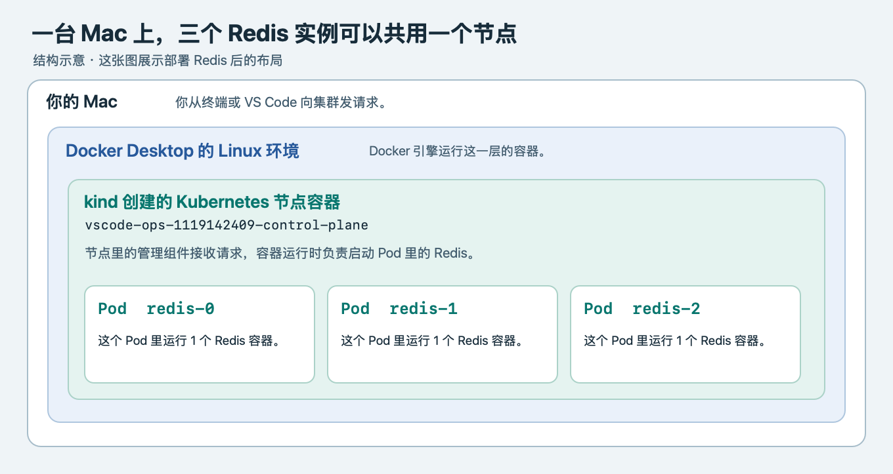
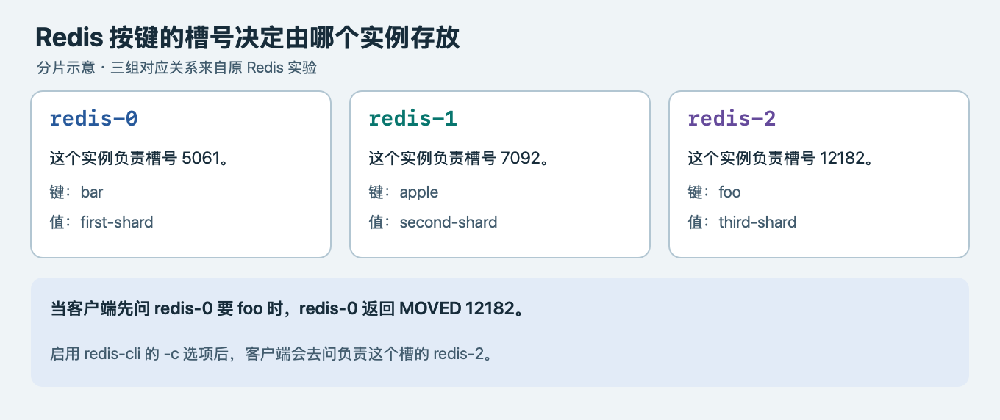

# 从零读懂 Docker、Kubernetes 与 Redis 实验

如果你第一次搭集群，请打开[《在 VS Code 终端里搭建第一个 Kubernetes 集群》](<在 VS Code 终端里搭建第一个 Kubernetes 集群.md>)，从第 1 步开始。遇到不懂的命令或配置，可以回到这里查它在操作哪个对象。

## 在项目里去哪里找配置文件？

在 VS Code 里打开笔记项目，展开「容器与 Kubernetes」，就能直接看到 Redis 清单。另外两个文件会在做实验时出现在练习目录。下面的路径假设你给集群取名 `my-k8s`。

| 你想看什么 | 在哪里找 | 谁使用它 |
| --- | --- | --- |
| Redis 的部署清单 | [打开 redis-lab.yaml](redis-lab.yaml)，或看本页的[完整中文注释](#redis-config)。 | 第 9 步的 `kubectl apply` 把文件里描述的应用交给 Kubernetes。 |
| 集群地址和访问凭据 | 第 4 步由 kind 生成 `~/Projects/my-k8s/kubeconfig`。在建集群前就可以先看本页的[脱敏示例](#connection)。 | kubectl 读取地址和凭据，再向集群发送请求。 |
| VS Code 的工作区设置 | 第 7 步在练习窗口创建 `~/Projects/my-k8s/.vscode/settings.json`。 | Kubernetes 插件读取这个文件，找到上面那份 kubeconfig。 |

## 一台 Mac 怎么运行一个集群和三个 Redis？

**Docker 负责运行容器，kind 借助 Docker 创建实验节点，Kubernetes 负责在节点上管理应用。** 在这台 Mac 上，Docker Desktop 提供一个 Linux 虚拟机，也就是运行在 Mac 内的一套 Linux 环境。Docker 引擎在这套环境里创建容器。**镜像**是程序与其所需文件的打包模板，**容器**是用这个模板创建的运行实例。同一镜像可以启动多个独立容器。 [Docker Desktop 与 Kubernetes](https://docs.docker.com/desktop/use-desktop/kubernetes/)

`kind` 的名字来自 Kubernetes IN Docker。在本实验中，它让一个 Docker 容器充当 Kubernetes 节点，新实验的容器名是 `my-k8s-control-plane`。**Pod** 是 Kubernetes 调度应用的最小单位，其中可以有一个或多个共享网络等资源的容器。本实验每个 Redis Pod 里有一个 Redis 容器，由节点里的 `containerd` 启动。`containerd` 是容器运行时，也就是负责拉取镜像并启动容器的程序。 [kind 的快速入门](https://kind.sigs.k8s.io/docs/user/quick-start/) · [Kubernetes 的 Pod](https://kubernetes.io/docs/concepts/workloads/pods/)



你运行 `docker ps` 时，Docker 可以列出这个 kind 节点容器，也能列出直接用 Docker 启动的 MySQL 和 PostgreSQL。你让 `kubectl` 连到实验集群后执行 `get pods -A`，Kubernetes 会列出这个集群的所有 Pod。本实验只有一个节点，所以这些 Pod 都由同一个节点承载。`kubectl` 是 Kubernetes 的命令行客户端，也就是替你向集群发请求的程序。VS Code 的 **Kubernetes** 面板通过同一个连接文件查看集群。

当你提交一条「我要三个 Redis Pod」的配置时，**应用程序接口服务器**（API server）接收请求，核对你的身份和权限，并把资源记录到 **etcd**，也就是保存 Kubernetes 集群状态的数据库。**控制器**持续比较你要求的状态和当前状态。它发现缺少实例时，会创建 Pod 对象。**调度器**为尚未分配节点的 Pod 选择可用节点。节点上的 **kubelet** 是负责落实任务的代理，它请容器运行时启动 Redis，并把运行情况报告回集群。 [Kubernetes 的各个组件](https://kubernetes.io/docs/concepts/overview/components/)

**控制平面**是负责接收请求、记录状态和安排工作的这组组件。你只有一个节点，因此这个节点同时承担管理工作和运行实验应用的工作。你在实验里看到的 `Ready` 表示节点报告自己已就绪。它不能代替对应用的检查，所以还要查看 Pod 是否已经启动，最终再用 Redis 客户端检查 Redis 能不能读写。


<a id="connection"></a>

## kubectl 怎样找到集群？

### 读懂 my-k8s 的 kubeconfig

你在 Mac 上输入 `kubectl get nodes`，意思是「请列出节点」。如果 Docker 里同时运行着 `my-k8s` 和之前搭好的练习集群，应该问哪一个？**`kubeconfig` 是 Mac 上的一份连接配置文件。它告诉 `kubectl` 去哪个地址、怎样确认对方是自己的集群，以及用什么身份证明去查询。** 节点名称和就绪状态由集群在收到查询后返回。

在《在 VS Code 终端里搭建第一个 Kubernetes 集群》的练习中，你在 `~/Projects/my-k8s` 执行了 `export KUBECONFIG="$PWD/kubeconfig"`。这一步只把文件路径记在当前终端的环境变量里。接着，`kind create cluster` 根据你传给 `--kubeconfig` 的路径，把连接信息写进这个文件。重新完成建集群的步骤后，你可以在任意终端运行下面的命令，查看文件的内容。命令里的 `$HOME` 代表你的个人目录。

```zsh
kubectl --kubeconfig "$HOME/Projects/my-k8s/kubeconfig" config view
```

下面给上一轮 my-k8s 实验保存的 YAML 加上中文注释，并把每个条目的名字放在前面，方便对照。YAML 用空格缩进表示归属，例如 `server` 属于它上面的 `cluster`。`-` 表示列表中的一项，`#` 后面的文字是写给读者的注释。命令显示的 `DATA+OMITTED` 表示证书或私钥的内容已省略，实际访问时使用 kind 写好的原文件。

```yaml
# kubectl 按 v1 版本的连接配置格式来读这份文件。
apiVersion: v1
# kind 字段说明这份文件是什么。Config 表示给 kubectl 使用的连接配置。
kind: Config

# clusters 收录可以选择的集群地址。这个例子只收录了一个。
clusters:
  - name: kind-my-k8s                 # 给这条集群记录起一个本地名字。
    cluster:
      # kubectl 会把查询发往这个地址。127.0.0.1 指这台 Mac 自己。
      # 在这次实验中，Docker 把本机 62435 端口的连接转给节点容器的 6443 端口。
      server: https://127.0.0.1:62435
      # kubectl 用这份证书核对服务器出示的身份证明。
      certificate-authority-data: DATA+OMITTED

# users 保存访问集群时可以选择的身份证明（凭据）。
users:
  - name: kind-my-k8s                 # 给这份凭据起一个本地名字。
    user:
      # 客户端证书向服务器说明这次请求使用哪个身份。
      client-certificate-data: DATA+OMITTED
      # kubectl 用配套的私钥在本机完成签名，证明它持有这份凭据。
      client-key-data: DATA+OMITTED

# contexts 保存访问方案。每个方案把一个集群和一份凭据配在一起。
contexts:
  - name: kind-my-k8s                 # 给这套搭配起一个名字。
    context:
      cluster: kind-my-k8s            # 到 clusters 中找这个名字，取得地址。
      user: kind-my-k8s               # 到 users 中找这个名字，取得凭据。

# 如果命令没有另外指定方案，kubectl 就到 contexts 中找这个名字。
current-context: kind-my-k8s
```

**为什么同一个名字出现六次？** 三处 `name` 分别给集群记录、凭据和访问方案命名。其余三处用这些名字查找已定义的条目。你自己写时可以取不同的名字。比如你在 `clusters` 中给原地址取名 `local-k8s`，在 `users` 中给原凭据取名 `local-cert`，那么文件最后两段就可以这样写：

```yaml
contexts:
  - name: my-lab
    context:
      cluster: local-k8s
      user: local-cert
current-context: my-lab
```

这段配置读作「默认选择 `my-lab` 方案，用 `local-cert` 这份凭据去访问 `local-k8s` 的地址」。写配置时先填实际的服务器地址和集群提供的凭据，再给它们起名，最后在方案中引用这些名字。`cluster`、`user` 等字段名由格式规定。例如，若你给 `get nodes` 加上 `--context no-such-context`，而 `contexts` 里没有这个名字，`kubectl` 会在发出查询前提示 `context was not found`。 [Kubernetes 的连接配置与 context](https://kubernetes.io/docs/concepts/configuration/organize-cluster-access-kubeconfig/)

### 读配置和向集群查询分别会看到什么

按操作手册创建 my-k8s 后，可以在 Ghostty 或 VS Code 的终端里运行下面两条命令。

```zsh
kubectl --kubeconfig "$HOME/Projects/my-k8s/kubeconfig" config current-context
kubectl --kubeconfig "$HOME/Projects/my-k8s/kubeconfig" get nodes
```

第一条在本地读出 `current-context` 的值，终端只打印方案名 `kind-my-k8s`。

第二条先按 `current-context` 的名字在 `contexts` 中选中方案，再按方案中的 `cluster` 到 `clusters` 里找地址，按方案中的 `user` 到 `users` 里找凭据。随后，`kubectl` 才向该地址发送查询，由节点容器里负责接收请求的 `kube-apiserver` 应答。服务器核实身份和查询权限后返回节点列表，终端才会显示 `my-k8s-control-plane`。你在 `STATUS` 列看到的 `Ready` 是服务器返回的节点状态。重新建集群时，本机端口可能变化，请以新文件的 `server` 为准。

当命令带有 `--kubeconfig` 时，kubectl 使用指定的文件。省略这个选项时，它会查看 `KUBECONFIG` 环境变量。如果也没有设置变量，默认位置是 `~/.kube/config`。这里的 `~` 表示你的个人目录。本实验通过指定文件路径，就能单独管理练习集群的连接。[Kubernetes 连接配置文档](https://kubernetes.io/docs/concepts/configuration/organize-cluster-access-kubeconfig/)

<a id="plugin-settings"></a>

### VS Code 为什么还有一个 settings.json？

下面用新练习目录的设置作示范。第一项让插件找到连接文件，再由连接文件提供服务器地址。第二项告诉插件去哪里启动 kubectl 程序。第 7 步只需要第一项。如果插件还提示找不到 kubectl，再按终端的实际输出填写第二项。

```jsonc
{
  "vs-kubernetes": {
    // 这里填写本次新建集群的连接文件路径。
    "vs-kubernetes.kubeconfig": "/Users/zhanghongze/Projects/my-k8s/kubeconfig"
  },
  // 这是本机 kubectl 程序的路径。可以用 command -v kubectl 查看。
  "vscode-kubernetes.kubectl-path": "/usr/local/bin/kubectl"
}
```

<a id="redis-config"></a>

## Redis 的 YAML 怎样变成三个正在运行的实例？

下面是实际提交的[完整清单](redis-lab.yaml)。第一次读，请先找到 `replicas: 3`，它决定 Pod 的数量。再找 `image:`，它指定每个 Pod 用哪份镜像启动 Redis。最后看 `serviceName: redis-peer`，组网命令里的 `redis-0.redis-peer` 就用到了这个名字。其余字段可以在做实验时按注释查阅。

```yaml
# 这份清单包含两个对象，由单独一行 --- 隔开。kubectl apply 时会把两者提交到 -n 指定的命名空间。
# 第一部分创建 Service。它让同一命名空间里的程序可以按名字找到各个 Redis 实例。
apiVersion: v1
kind: Service
metadata:
  name: redis-peer
spec:
  # None 表示创建无头服务。配合下面的 StatefulSet，redis-0.redis-peer 可以解析到 redis-0 的 Pod 地址。
  clusterIP: None
  # 服务按标签挑选 Pod。这里的 app: redis-lab 要和下方 template.metadata.labels 里的值相同。
  selector:
    app: redis-lab
  ports:
    # 6379 接收读写命令。16379 供 Redis 成员交换集群状态。这两个端口供集群内部使用。
    - name: client
      port: 6379
    - name: cluster-bus
      port: 16379
---
# 第二部分创建 StatefulSet。它按同一份模板启动多个 Pod，并给它们保留有序的名字。
apiVersion: apps/v1
kind: StatefulSet
metadata:
  name: redis
spec:
  # 这里引用上面 Service 的名字，因此三个 Pod 可以使用 redis-0.redis-peer 等地址互相联系。
  serviceName: redis-peer
  # Kubernetes 要维护三个 Pod，名字由 redis 加上编号组成：redis-0、redis-1、redis-2。
  # 三个 Pod 可以同在一个节点上。稍后由 redis-cli --cluster create 让三个 Redis 组成分片集群。
  replicas: 3
  selector:
    # StatefulSet 管理带有这个标签的 Pod。下方模板会给每个新 Pod 贴上同样的标签。
    matchLabels:
      app: redis-lab
  # 从这里往下读的是单个 Pod 的模板。每个 Pod 都按 containers 列表启动一个 Redis 容器。
  template:
    metadata:
      labels:
        app: redis-lab
    spec:
      containers:
        - name: redis
          image: redis:8.2.11-alpine
          # 节点已有上面这个版本的镜像时直接复用，缺少时才下载。
          imagePullPolicy: IfNotPresent
          # 列表中的每一项都是传给容器的一个参数。例如 --cluster-enabled 和下一行的 yes 要连起来读。
          args:
            - redis-server
            # Redis 监听 Pod 的全部 IPv4 网卡，并关闭保护模式，让同集群的实例能互连。本实验没有配置密码。
            - --bind
            - 0.0.0.0
            - --protected-mode
            - "no"
            # 启用 Redis 的集群功能。刚启动时各实例仍需要执行组网命令才能分工。
            - --cluster-enabled
            - "yes"
            # Redis 把成员身份、槽位等组网信息记在 /data/nodes.conf 中。
            - --cluster-config-file
            - /data/nodes.conf
            # Redis 把自己的 Pod 地址告诉其他成员。下面 env 提供 POD_IP 的实际值。
            - --cluster-announce-ip
            - $(POD_IP)
            # 空字符串关闭定时快照，下面的 no 关闭追加日志。此实验的键值只存在内存里。
            - --save
            - ""
            - --appendonly
            - "no"
          env:
            - name: POD_IP
              valueFrom:
                fieldRef:
                  # Kubernetes 从当前 Pod 的状态取得它分配到的 IP，供上方启动参数使用。
                  fieldPath: status.podIP
          ports:
            - name: client
              containerPort: 6379
            - name: cluster-bus
              containerPort: 16379
          # Kubernetes 尝试连接名为 client 的 6379 端口。连通后，列表中的 READY 可以变成 1/1。
          # 要确认三个成员已组网且能读写，还要查 Redis 的 cluster info，并实际执行 SET 和 GET。
          readinessProbe:
            tcpSocket:
              port: client
          resources:
            # 调度时按每个容器需要 0.05 核 CPU 和 32 MiB 内存来安排。下面的 128 MiB 是单容器内存上限。
            requests:
              cpu: 50m
              memory: 32Mi
            limits:
              memory: 128Mi
          # 把下面名为 lab-data 的目录挂到容器内的 /data，供 Redis 保存成员配置。
          volumeMounts:
            - name: lab-data
              mountPath: /data
      volumes:
        - name: lab-data
          # 每个 Pod 各有一个临时目录。同一 Pod 内容器重启时目录保留，Pod 被替换后新 Pod 得到空目录。
          emptyDir: {}
```

当 Pod 显示 `1/1 Running` 时，Kubernetes 已经能连上 Redis 的 6379 端口。操作手册里还有一步 `redis-cli --cluster create`，它让三个实例认识彼此，分配存储数据的责任。一个节点上运行三个 Redis 可以用来练习分片。如果这台节点停机，三个实例都会受到影响。

<a id="shards"></a>

## 从一个 Redis 发出请求，怎样知道数据由谁保存？

Redis 根据键名算出一个编号，称为哈希槽。三个主实例各负责一段编号。在操作手册第 9 步写入 `harry:hello` 后，在同一终端运行下面的命令。第一条计算这个键的槽号，第二条显示每个成员负责的槽号范围，第三条列出各个 Pod 的 IP 地址。先找包含该槽号的范围，再用这一行的地址对照 Pod 的 IP 列，就能找到负责它的实例。

```zsh
kubectl -n redis-lab exec redis-0 -- redis-cli CLUSTER KEYSLOT harry:hello
kubectl -n redis-lab exec redis-0 -- redis-cli CLUSTER NODES
kubectl -n redis-lab get pods -o wide
```



图中用的是另一组练习键。当时 `foo` 的槽号是 12182，负责它的是 `redis-2`。如果客户端向其他成员查这个键，就可能看到 `MOVED` 和目标地址。给 `redis-cli` 加上 `-c`，客户端就会按地址继续查询。你从另一个 Pod 成功读回数据，说明客户端能找到负责这个键的成员。若要看哪些成员真正保存了哪些键，请结合当次槽位分配判断。[Redis 分片说明](https://redis.io/docs/latest/operate/oss_and_stack/management/scaling/)

<a id="containers"></a>

## 扩展：怎样用 VS Code 查看节点容器的日志？

完成操作手册第 4 步后，Docker 里就有一个叫 `my-k8s-control-plane` 的容器。你可以拿这个正在工作的节点练习查看日志。

在 VS Code 按 `⌘⇧X` 打开扩展面板，搜索 `@id:ms-azuretools.vscode-containers`。安装或启用 Microsoft 的 Container Tools 插件后，点击左侧的容器图标。在 **Containers** 分区展开 **Individual Containers**，找到名字为 `my-k8s-control-plane` 的容器。右键选择 **View Logs**，就能看到节点容器启动时留下的输出。如果列表为空，先确认 Docker Desktop 已启动，再点击面板中的刷新按钮。

在 Ghostty 中也可以查看同一个容器的最后二十行日志：

```zsh
docker --context desktop-linux logs --tail 20 my-k8s-control-plane
```

如果你要查 Redis 自己输出了什么，请按操作手册第 9 步打开 Kubernetes 面板中的 Redis Pod。一个面板展示 Docker 节点容器，另一个面板可以继续查看节点里运行的应用。
