# 在 VS Code 终端里搭建第一个 Kubernetes 集群

你可以在一台 Mac 上搭出一个只有一个节点的 Kubernetes 集群。Kubernetes（简称 K8s）帮你管理应用。例如，你可以要求它保持三个 Redis 数据库实例运行。它记录这个要求，安排实例运行，并在实例丢失时尝试补足。**集群**是由 Kubernetes 一起管理的一组运行环境，**节点**是其中一个能运行程序的环境。这次你会亲手创建一个节点，看见它从启动变成 `Ready`（就绪），再在 VS Code 左侧找到同名节点。做到这里，搭建就完成了。

第一次操作请从第 1 步开始。本文把集群命名为 `my-k8s`。前几步的截图取自名为 `first-k8s` 的早期演示，你在自己终端里要找的是 `my-k8s-control-plane`。第 9 步的截图记录了在 `my-k8s` 上部署 Redis 和读写数据的全过程。

练习用的 [Redis 清单](redis-lab.yaml) 就在这篇手册旁边。连接配置由第 4 步生成。你可以先看[两份 YAML 和插件设置的中文示范](<从零读懂 Docker、Kubernetes 与 Redis 实验.md>)，再对照自己的文件。

## 第 1 步　在 VS Code 中找到输入命令的位置

你可以在阅读本文的窗口中开始。请在 Mac 屏幕顶部点击「终端」，再点击「新建终端」。窗口底部会出现选中的「终端」标签。请点一下闪动的光标，输入下面三个字母，再按回车。

```zsh
pwd
```

终端让你用文字操作电脑。Mac 上的 **zsh** 是读懂这行文字并执行它的程序。`pwd` 会打印终端当前所在文件夹的完整路径。你可能看到项目路径，也可能看到自己的个人目录。这一步只查询位置。彩色的用户名、时间和 `❯` 都是终端给你的提示，只需要输入代码框里的文字。后面每条命令都等提示符重新出现后再输入。[VS Code 终端说明](https://code.visualstudio.com/docs/terminal/basics)

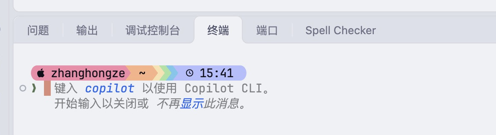

## 第 2 步　先确认三个工具都能工作

请先在 Mac 的「应用程序」里打开 **Docker Desktop**。它在 Mac 上运行一个 Linux 环境，里面的 Docker 引擎负责启动容器。**镜像**是打包好的程序与运行所需文件，**容器**是用镜像启动的一个独立实例。

请在刚才的终端逐行运行下面的命令。每一行回答一个问题。

```zsh
docker context show
docker --context desktop-linux info --format '{{.ServerVersion}}'
kind version
kubectl version --client
```

| 你在问什么 | 你怎样读结果 |
| --- | --- |
| Docker 命令目前选中了哪个引擎？ | 第一行读取 Docker 的连接配置。这台 Mac 显示 `desktop-linux`，它指向 Docker Desktop 里的 Linux 引擎。 |
| 这个引擎真的能回答吗？ | 第二行明确向 `desktop-linux` 查询。末尾的参数让 Docker 只打印服务端版本。本次返回 `29.3.1`。如果提示无法连接，请等 Docker Desktop 启动完成再执行这一行。 |
| 谁负责搭建集群？ | **kind** 的名字取自 Kubernetes in Docker。它会让 Docker 启动容器，并将容器配置成 Kubernetes 节点。`kind version` 只查看工具版本，本机显示 `v0.33.0`。 |
| 集群建好后，谁帮我查询节点？ | **kubectl** 是向 Kubernetes 发送命令的客户端。`--client` 让它只报告本机工具版本，本机显示 `Client Version: v1.34.1`。这时还没有向新集群发请求。 |

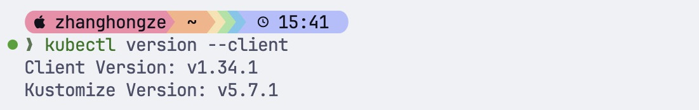

如果上面的命令都能返回版本或连接名称，就可以继续第 3 步。如果你的 Mac 使用 Homebrew 管理软件，缺少哪个工具就补装哪个。缺少 Docker Desktop 时，运行 `brew install --cask docker-desktop` 并从「应用程序」首次打开它。缺少 kind 时，运行 `brew install kind`。使用 kind 只需要 Docker 引擎工作，Docker Desktop 设置里的 Kubernetes 开关可以保持原样。[Docker Desktop 安装包](https://formulae.brew.sh/cask/docker-desktop) · [kind 入门指南](https://kind.sigs.k8s.io/docs/user/quick-start/)

本文的集群使用 Kubernetes 1.35，搭配 1.34、1.35 或 1.36 版 kubectl 都在官方支持范围内。如果新电脑缺少合适的 kubectl，可以运行 `brew install kubernetes-cli@1.35`，然后在练习终端运行 `export PATH="$(brew --prefix kubernetes-cli@1.35)/bin:$PATH"`。这会让当前终端优先使用刚装的版本。换新终端时也要重新执行这一行，再用 `kubectl version --client` 检查。[Kubernetes 版本兼容说明](https://kubernetes.io/releases/version-skew-policy/#kubectl) · [Homebrew 安装包说明](https://formulae.brew.sh/formula/kubernetes-cli@1.35)

## 第 3 步　给自己的集群取名，准备存放连接文件的目录

在同一个终端里逐行执行下面的命令。第一行让随后启动的程序使用本机 Docker Desktop。第二行给新集群起名。等号两边都没有空格。第三行列出这个引擎上已有的 kind 集群。

```zsh
export DOCKER_CONTEXT=desktop-linux
LAB_NAME=my-k8s
kind get clusters
```

如果列表里还没有 `my-k8s`，可以继续创建。如果已经有同名集群，可以按第 8 步连接并查询它。下文各处都使用同一个练习名。

```zsh
mkdir -p "$HOME/Projects"
LAB_DIR="$HOME/Projects/$LAB_NAME"
mkdir -m 700 "$LAB_DIR" && cd "$LAB_DIR" && pwd
```

`LAB_DIR` 是你给路径取的临时名字。`$HOME` 代表个人目录，`$LAB_NAME` 取出刚选的集群名。最后一行先创建练习文件夹，`-m 700` 让当前账户可以进入、读写这个私有目录。`&&` 表示前一条成功才继续。因此创建成功后，`cd` 会让终端进入文件夹，`pwd` 会打印路径。你在这台 Mac 上应该看到 `/Users/zhanghongze/Projects/my-k8s`。如果报 `File exists`，先运行 `ls -la "$LAB_DIR"` 查看目录，以及 `kind get clusters` 核对集群名。如果已经有自己的 `my-k8s`，直接按第 8 步连接。如果集群已经删除，而且你确认这个目录只是上次留下的专用练习目录，可以执行 `cd "$LAB_DIR" && pwd`，再继续下面的 `export KUBECONFIG` 和第 4 步。kind 会在这个目录重新写入连接文件。如果目录属于其他项目，请另选练习名，并在后文的路径、集群名和节点名中使用新名字。

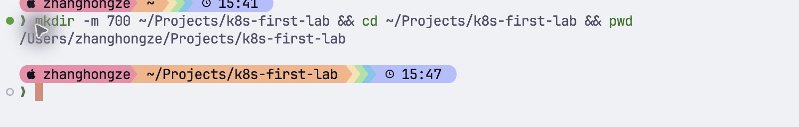

现在告诉终端，稍后把集群的连接资料放在哪里。

```zsh
export KUBECONFIG="$PWD/kubeconfig"
```

`$PWD` 是当前目录的完整路径。`export` 让随后从这个终端启动的程序也能读到这个变量。这一行通常没有输出，它只选定文件位置。下一步由 kind 写出 **kubeconfig** 文件，里面有集群地址和访问凭据。以后你可以告诉插件文件在哪里，文件内容要留在本机。

## 第 4 步　让 kind 真正创建集群

请先复制下面一整行。它把本次要使用的**节点镜像**保存到变量里。这个镜像包含启动 Kubernetes 节点所需的软件。`v1.35.8` 是选用的 Kubernetes 版本，`sha256:` 后面的长串字符指定了确切的镜像内容。Docker Desktop 若已有该镜像就会复用，否则 kind 会下载它。

```zsh
NODE_IMAGE='kindest/node:v1.35.8@sha256:07b2536e30b803ed61d1677a79df6115f798ce64c80f9e22f6ed45afd09323c0'
```

**下面这一行才会创建集群。** 请在原终端执行它，并等提示符重新出现。

```zsh
kind create cluster --name "$LAB_NAME" --image "$NODE_IMAGE" --kubeconfig "$KUBECONFIG" --wait 180s
```

你可以把这行读成一句话：“请 kind 创建一个叫 `my-k8s` 的集群，用我选好的镜像启动节点，把连接资料写入我选好的文件，再等待控制平面就绪。”**控制平面**是负责接收指令、记录期望状态和安排工作的那组程序。`--wait 180s` 允许 kind 在就绪检查这一步最多等待三分钟。下载镜像等前置工作也需要时间。[kind 创建集群的参数说明](https://kind.sigs.k8s.io/docs/user/quick-start/#creating-a-cluster)

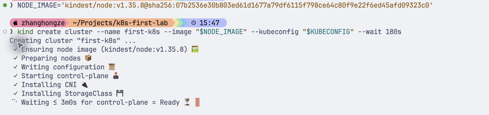

当你看到 `Preparing nodes` 时，kind 正在准备节点容器。当你看到 `Installing CNI` 时，它正在安装让集群里的程序互相通信所需的网络组件。`Installing StorageClass` 表示它正在配置以后申请存储时可以使用的默认方式。出现 `Ready after …` 并回到提示符后，就可以查询了。这次就绪检查用了 17 秒，你的时间可以不同。

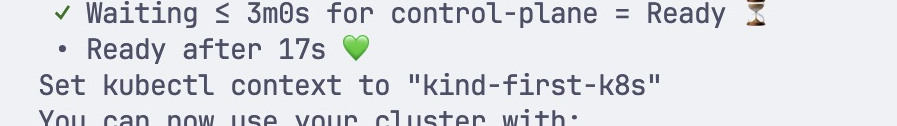

## 第 5 步　亲眼确认查询的是哪个集群、哪一个节点

请在同一终端逐行运行下面两条命令。

```zsh
kubectl config current-context
kubectl get nodes
```

第一条从连接文件读取当前的 **Kubernetes context**，也就是一组有名字的连接选择，里面指定集群、访问身份，还可以指定默认的资源分组。你的输出应为 `kind-my-k8s`。第 2 步的 Docker context 选择的是 Docker 引擎，这里的 context 选择的是 kubectl 访问 Kubernetes 时使用的连接。[Kubernetes 连接配置说明](https://kubernetes.io/docs/concepts/configuration/organize-cluster-access-kubeconfig/)

如果你想打开刚生成的文件，看看 `kubectl` 到底从哪里找地址和身份证明，可以对照[带中文注释的 kubeconfig 示例](<从零读懂 Docker、Kubernetes 与 Redis 实验.md#connection>)逐行读。

第二条会真正联系集群，请它列出节点。请用手指在屏幕上找到 **同一行** 的三项内容。

| 要看的列 | 在你的练习里意味着什么 |
| --- | --- |
| `NAME` | `my-k8s-control-plane` 是新节点的名字。这次只有一行，因为只创建了一个节点。 |
| `STATUS` | `Ready` 表示节点报告自己已就绪。如果刚启动时显示 `NotReady`，稍等片刻再运行同一条查询。 |
| `ROLES` | `control-plane` 表示这个节点运行了管理集群的程序。在本次单节点 kind 集群里，它也可以运行练习应用。 |

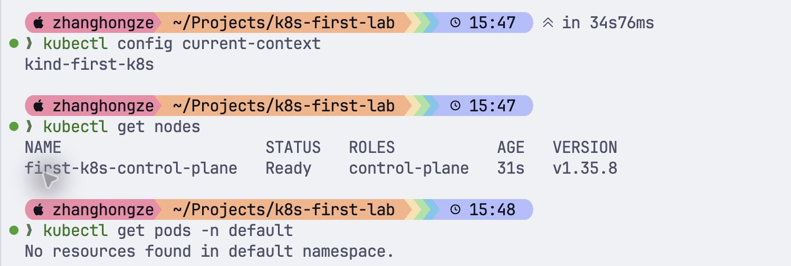

你也可以从 Docker 这一侧看同一个节点。下面的命令只列出名字匹配的运行中容器，并只显示名称和运行状态。你会看到 `my-k8s-control-plane` 和 `Up`。Docker 看到承载节点的容器在运行。上面的 kubectl 查询还能告诉你里面的节点是否就绪。

```zsh
docker ps --filter "name=$LAB_NAME-control-plane" --format '{{.Names}}  {{.Status}}'
```

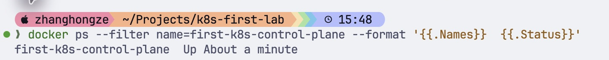

## 第 6 步　弄清为什么有节点，列表里却还没有应用

**Pod** 是 Kubernetes 用来一起运行一个或多个容器的单位。**命名空间**（namespace）是集群给资源划分的有名字的分组。请在同一终端运行下面两行，留意唯一换掉的分组名。`-n` 指定本次查询的命名空间。

```zsh
kubectl get pods -n default
kubectl get pods -n kube-system
```

刚建好时，第一条会返回 `No resources found in default namespace.`。这句话的意思是“查询成功，默认分组里有零个 Pod”。第二条会列出系统自己需要的 Pod。例如，名字以 `kube-apiserver` 开头的那一行就是接收 kubectl 请求的程序。`Running` 表示 Pod 处于运行阶段，`READY` 列里的 `1/1` 表示这个 Pod 一共一个应用容器，现在这一个已就绪。你看到的名称末尾和运行时间可能不同。

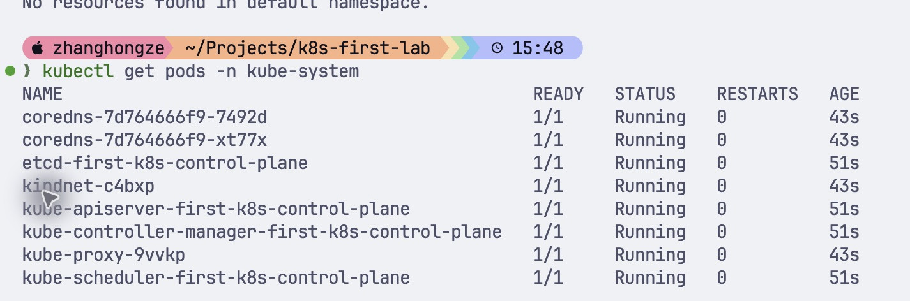

至此，你已经验证了三件事：终端能联系到你选的集群，节点已经就绪，系统程序正在运行。Redis 是后续练习要部署的应用。仅仅把 `redis-lab.yaml` 复制到文件夹，只会增加一个本地文件。

## 第 7 步（可选）　在 VS Code 插件里查看集群和容器

如果只想在终端完成 Redis 实验，可以直接去第 8 步。想看图形界面时，在 VS Code 按 `⌘⇧X`，搜索并启用 Microsoft 的 Kubernetes 插件（`ms-kubernetes-tools.vscode-kubernetes-tools`）。

**先取得文件路径。** 在刚才查询成功的终端里运行下面这行。它只打印路径。请复制从 `/Users/` 开始、到 `/kubeconfig` 结束的整行。

```zsh
printf '%s\n' "$KUBECONFIG"
```

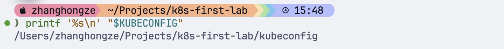

**再打开练习文件夹。** 请在这个终端运行 `code -n .`。`code` 打开 VS Code，`-n` 要求新窗口，末尾的点代表当前文件夹。若终端找不到 `code`，你也可以在 VS Code 按 `⌘⇧N` 新建窗口，然后在「文件」菜单选择「打开文件夹…」，打开第 3 步打印的练习目录。这样操作后，原教程仍在原窗口。如果 VS Code 询问是否信任这个文件夹，请先核对显示的路径，确认是自己刚创建的练习目录后再选择信任。

**让这个窗口记住路径。** 在新窗口按 `⌘⇧P` 打开命令面板，搜索「打开工作区设置(JSON)」或 `Preferences: Open Workspace Settings (JSON)`，选带有「工作区」的那一项。VS Code 会打开当前文件夹的 `.vscode/settings.json`。JSON 是一种用文字保存设置的格式。如果里面只有空的花括号，就用下面的完整内容替换它，把路径换成刚复制的实际值，然后按 `⌘S` 保存。如果你刚复制了示例，路径已从剪贴板消失，可以在新窗口左侧右键点击 `kubeconfig`，选择「复制路径」，再替换双引号中的文字。

如果原文件已有其他设置，请保留它们。若已经有同名路径，只需替换引号里的值。若缺少整个 `"vs-kubernetes"` 项，请在原来的最后一项末尾加一个英文逗号，再把示例中从 `"vs-kubernetes"` 到内层右花括号的三行放在它后面。

```json
{
  "vs-kubernetes": {
    "vs-kubernetes.kubeconfig": "/Users/zhanghongze/Projects/my-k8s/kubeconfig"
  }
}
```

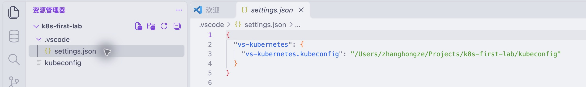

**最后展开节点。** 请点 VS Code 最左侧的舵轮图标。侧栏标题应为 **Kubernetes**。展开 **Clusters** 下面的 `kind-my-k8s`，再展开 **Nodes**。这里的节点名应该和第 5 步终端的 `NAME` 完全相同。要看集群中的节点，请认准图中的舵轮。[Kubernetes 扩展的连接设置](https://github.com/vscode-kubernetes-tools/vscode-kubernetes-tools#working-with-kubeconfigs)

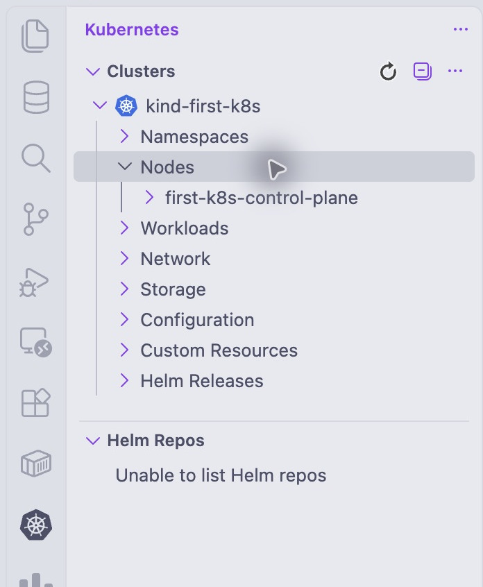

图中下方的 `Unable to list Helm repos` 属于 Helm，一种额外的应用安装工具。本步只需在 **Nodes** 下看到预期节点名。

如果左边找不到舵轮，请按 `⌘⇧X` 打开扩展面板，搜索 `@id:ms-kubernetes-tools.vscode-kubernetes-tools`，确认 **Kubernetes** 扩展已安装并启用。如果有舵轮但 **Clusters** 为空，先核对当前窗口打开的文件夹和上图设置里的路径，保存后点 **Clusters** 标题旁的刷新按钮。如果插件提示找不到 kubectl，请在终端运行 `command -v kubectl`，再对照[带注释的插件设置](<从零读懂 Docker、Kubernetes 与 Redis 实验.md#plugin-settings>)填写返回的程序路径。

在左侧的 Containers 面板中展开 **Individual Containers**，可以找到 Docker 用来承载节点的 `my-k8s-control-plane`。如果想看它的日志，请按[容器插件的操作示例](<从零读懂 Docker、Kubernetes 与 Redis 实验.md#containers>)打开该面板。

## 第 8 步　下次打开终端，怎样回到今天的集群

如果你一直在同一个终端，可以直接继续第 9 步。如果你重新打开 Ghostty 或 VS Code 的终端，先让新终端读取本次练习的连接文件。如果第 2 步为特定版本的 kubectl 设置过 `PATH`，请在新终端先重复那条 `export PATH` 命令。

```zsh
export KUBECONFIG="$HOME/Projects/my-k8s/kubeconfig"
kubectl config current-context
kubectl get nodes
```

第一条查询应显示 `kind-my-k8s`，第二条应列出 `my-k8s-control-plane`。如果连接被拒绝，可以打开 Docker Desktop，在 Containers 面板中查找这个名字。若它已停止，可以选中同名容器并启动，再查询节点。如果第 4 步尚未成功或你已删除这个集群，请回到第 3 步核对集群名和目录。

<a id="my-k8s-redis"></a>

## 第 9 步　在 my-k8s 上运行 Redis 集群

你已经有了一台能运行应用的 Kubernetes 节点。这次要让它运行三个 Redis 实例，再让三个实例分工保存数据。下面的命令可以在 Ghostty 或 VS Code 的同一个终端里逐段执行。命令使用本机笔记项目的位置。如果你把项目放在其他位置，请将 `-f` 后的路径替换成你的 Redis 清单的完整路径。截图记录的是一次已经成功的实验。如果你正在查看这次实验的结果，选中集群后可以直接执行查询状态和读取键值的命令。

### 选中节点，提交应用清单

```zsh
export KUBECONFIG="$HOME/Projects/my-k8s/kubeconfig"
kubectl get nodes
```

请在输出中找到 `my-k8s-control-plane`，确认它的状态为 `Ready`。首次部署时，先创建名为 `redis-lab` 的命名空间，给这次练习的资源单独分组。如果已创建这个分组，可以从下一条 `apply` 继续。

```zsh
kubectl create namespace redis-lab
kubectl -n redis-lab apply -f "$HOME/Projects/Ops-from-begginer-to-grave/容器与 Kubernetes/redis-lab.yaml"
```

`-n` 选中分组，`-f` 指向要提交的文件。打开[Redis 清单原件](redis-lab.yaml)，也可以对照[手册里的完整注释](<从零读懂 Docker、Kubernetes 与 Redis 实验.md#redis-config>)。先找 `kind: Service`，它让三个实例能按名字找到彼此。再找 `kind: StatefulSet` 和它下面的 `replicas: 3`，这要求 Kubernetes 维持三个有固定名字的 Pod。一个 Pod 是 Kubernetes 运行容器的单位，这次每个 Pod 运行一个 Redis 容器。

### 确认三个 Pod 在哪里运行

```zsh
kubectl -n redis-lab rollout status statefulset/redis --timeout=180s
kubectl -n redis-lab get pods -o wide
```

第一条最多等三分钟，第二条用 `-o wide` 多显示 IP 地址和节点名。找到 `redis-0`、`redis-1` 和 `redis-2` 三行，每行都应显示 `1/1 Running`。看这三行的 `NODE` 列，它们都运行在 `my-k8s-control-plane` 上。如果等待超时且出现 `ImagePullBackOff`，说明节点拉取镜像遇到了问题。可以用 `kubectl -n redis-lab describe pod redis-0` 查看末尾的 `Events`。等三个容器都就绪后，再给 Redis 组网。

### 让三个 Redis 分工保存数据

下面的创建命令用于第一次给三个空实例组网，执行一次即可。`exec redis-0 --` 表示让 Kubernetes 在 `redis-0` 的容器里执行后面的命令。`redis-cli` 是 Redis 自带的命令行客户端，它会联系下面三个地址，让三个成员各负责一段数据槽。Redis 给每个键算出一个槽号，再把这个键交给负责该槽的成员。`--cluster-replicas 0` 表示每个主成员有零个备用副本。

```zsh
kubectl -n redis-lab exec redis-0 -- redis-cli --cluster create \
  redis-0.redis-peer:6379 redis-1.redis-peer:6379 redis-2.redis-peer:6379 \
  --cluster-replicas 0 --cluster-yes
```

看到 `[OK] All 16384 slots covered.`，表示全部槽位都已分配。如果要查看已组好的集群，可以直接执行下行。预期能找到 `cluster_state:ok`、`cluster_slots_assigned:16384` 和 `cluster_known_nodes:3`。最后一个数字是 **Redis 成员数**，而前面 `kubectl get nodes` 列出的是 **Kubernetes 节点数**。

```zsh
kubectl -n redis-lab exec redis-0 -- redis-cli cluster info
```

### 写入一个键，再从另一个 Pod 发起读取

```zsh
kubectl -n redis-lab exec redis-0 -- redis-cli -c SET harry:hello "hello from my-k8s"
kubectl -n redis-lab exec redis-1 -- redis-cli -c GET harry:hello
```

第一条写入或覆盖练习键 `harry:hello`，成功时返回 `OK`。第二条从 `redis-1` 发起查询。`-c` 让客户端根据 Redis 的指引找到负责这个键的成员，最终读到 `hello from my-k8s`。

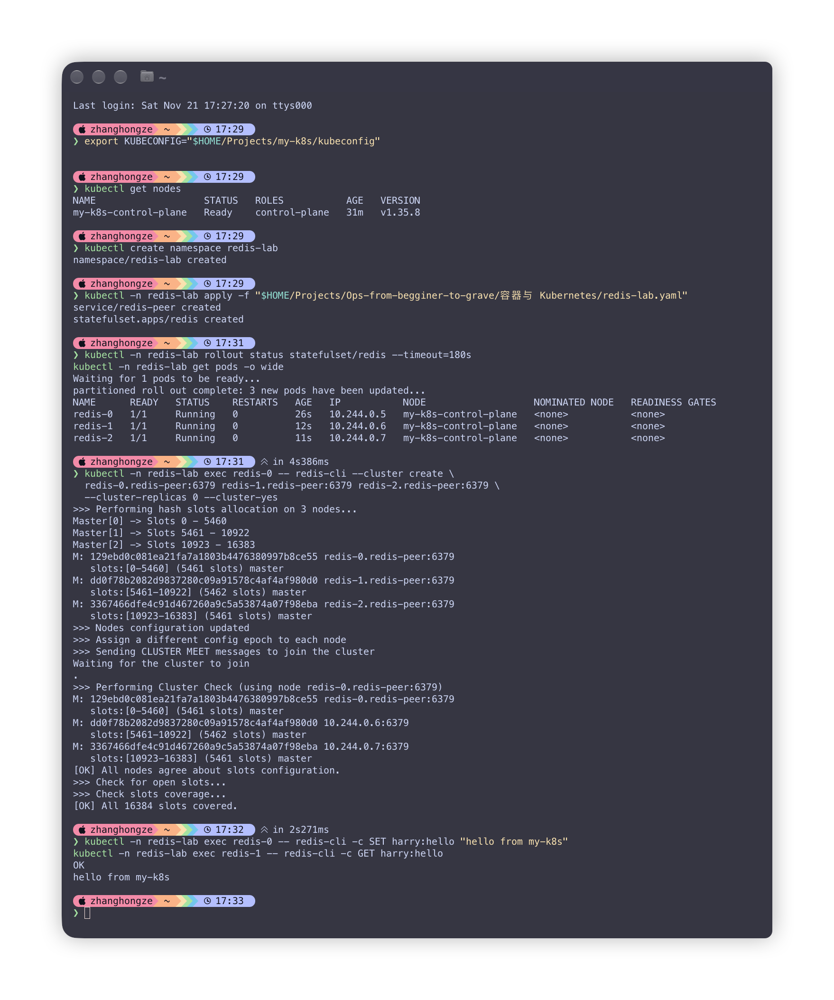

读这张实操截图时，可以从上往下核对三处。Pod 表格里的三行共用同一个 `NODE`。组网命令末尾报告全部 16,384 个槽已覆盖。最后两行输出是 `OK` 和 `hello from my-k8s`。它们分别记录了应用启动、Redis 完成分工和一次实际读写。

### 也可以在 VS Code 里看 Redis 的日志

在第 7 步打开的练习窗口里，按 `⌘⇧P`，搜索并执行 `Kubernetes: Use Namespace`。选中 `my-k8s` 的连接（若提示）和 `redis-lab` 命名空间。打开左侧的 Kubernetes 面板，展开 **Workloads** 下的 **Pods**，右键点击 `redis-0`，选择 **Logs**。若日志页显示 **Run** 按钮，点击后即可读取输出。在终端运行下一节的 `kubectl logs` 命令，可以查看同一个 Pod 的日志。

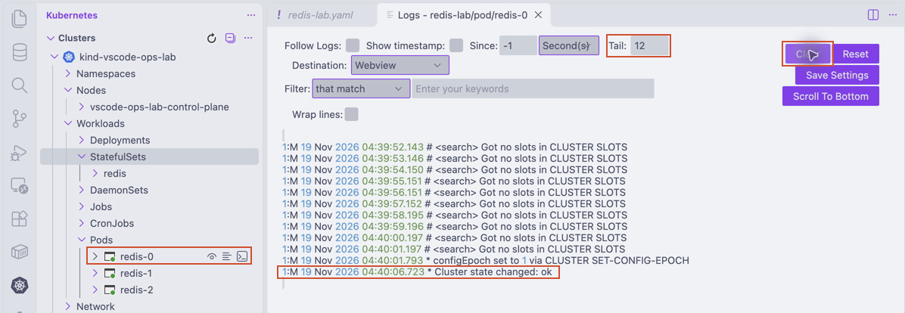

### 如果 Pod 一直没有就绪，怎样查原因？

在选中 `my-k8s` 的终端里执行下面两行。第一条的 `Events` 段记录 Kubernetes 拉镜像、启动容器时发生的事。第二条读取 Redis 程序最近的日志。如果容器反复退出，可以在日志命令末尾加 `--previous` 查看上一次运行的输出。

```zsh
kubectl -n redis-lab describe pod redis-0
kubectl -n redis-lab logs redis-0 --tail=30
```

如果 `Events` 确认节点拉不到 Redis 镜像，但 Docker Desktop 可以下载，可以在本实验的 Apple 芯片 Mac 上执行下面几行。它们先将镜像保存到练习目录，再导入 `my-k8s` 节点，最后等待 Redis 就绪。

```zsh
docker --context desktop-linux pull --platform linux/arm64 redis:8.2.11-alpine
docker --context desktop-linux image save --platform linux/arm64 -o "$HOME/Projects/my-k8s/redis-arm64.tar" redis:8.2.11-alpine
DOCKER_CONTEXT=desktop-linux KIND_EXPERIMENTAL_PROVIDER=docker kind load image-archive "$HOME/Projects/my-k8s/redis-arm64.tar" --name my-k8s
kubectl -n redis-lab rollout status statefulset/redis --timeout=180s
```

## 练习结束后，怎样只清理自己的资源？

如果明天还想继续，可以直接关闭终端。准备清理时，先在终端执行下面的查询，核对连接文件和 Docker 中的集群名称。

```zsh
export KUBECONFIG="$HOME/Projects/my-k8s/kubeconfig"
kubectl config current-context
kubectl get nodes
DOCKER_CONTEXT=desktop-linux KIND_EXPERIMENTAL_PROVIDER=docker kind get clusters
```

确认结果分别包含 `kind-my-k8s`、`my-k8s-control-plane` 和 `my-k8s` 后，再按目的选下面一种操作。

如果只想清理 Redis，下面一行会删除整个 `redis-lab` 分组，包括其中的实例和临时数据。之后可以从第 9 步重新部署。

```zsh
kubectl delete namespace redis-lab
```

如果想删除整个练习集群，下面一行会移除 `my-k8s` 的节点容器及其中的所有应用和数据。再次运行 `DOCKER_CONTEXT=desktop-linux kind get clusters` 即可核对删除结果。Mac 上的笔记、截图和练习文件夹仍可以查看。

```zsh
DOCKER_CONTEXT=desktop-linux KIND_EXPERIMENTAL_PROVIDER=docker kind delete cluster --name my-k8s --kubeconfig "$HOME/Projects/my-k8s/kubeconfig"
```
